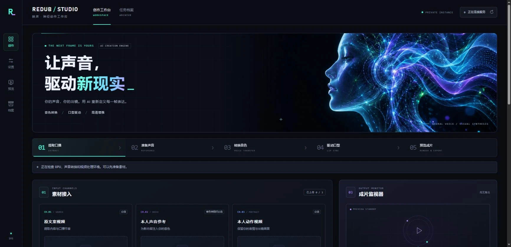

# REDUB STUDIO · 映声口播工作台

将已有视频的口播转换为参考音色，用人物动作视频生成对应口型，再合成可预览、下载的成片。适用于本人或已获授权素材的单用户私有测试。

已接入 ChatterboxVC 音色转换、TBDub Student 视频对口型、可选 Demucs 背景分离与回混，以及可选 Real-ESRGAN 高清增强。界面支持上传、音频预听、进度与日志、任务历史、取消和重试。

赛博朋克创作界面采用 AI 生成的全息声纹视觉、青紫霓虹和控制台布局，适配桌面与手机。素材计数、运行环境和任务进度来自实际状态；所有字体与视觉资源均无需外部 CDN。



预览图为尚未配置模型的本地空工作台。视觉素材的生成方式和完整提示词见 [UI 设计记录](docs/ui-art-direction.md)。

## 工作流程

```text
原文案视频 → 提取口播 → 可选分离背景 → 可选参考音色转换 ──┐
                                                        ↓
人物动作视频 → 统一25fps时间轴 → 分段TBDub口型 → 拼接与背景回混
                                                        ↓
                                         原版成片 → 可选超分 → 高清版
```

FastAPI/Uvicorn 提供网页与 API，单个工作进程串行执行任务。Web、口型、换声、背景分离使用各自的 Python 环境；模型通过子进程按阶段运行，高清增强复用 TBDub 环境。模型、缓存和任务媒体保存在实例数据盘，仓库提供源码与部署方法，不包含权重或用户媒体。

TBDub 在 512×512 对齐人脸区域生成后回贴到人物画面。输出清晰度受人物原素材和脸部生成影响；提高导出尺寸不能补回真实细节。高清增强采用 RealESRGAN_x2plus，将 70% AI 结果与 30% Lanczos 参考混合，不额外进行扩散重绘或人脸修复。原版和高清版同时保留，便于对比嘴形、牙齿及连续帧。

## 部署与使用

完整流程见 [Ubuntu / AutoDL 部署说明](docs/deployment.md)。默认部署目录为 `/root/redub-deploy`；脚本不会创建、开关或续费云实例。

```bash
git clone https://github.com/BruceLiu3385/REDUB-STUDIO.git /root/redub-deploy
cd /root/redub-deploy

# 先准备 TBDub 环境与权重。
bash deploy/tbdub_autodl/00_check_hardware.sh
bash deploy/tbdub_autodl/01_install_environment.sh
bash deploy/tbdub_autodl/02_download_student.sh
bash deploy/tbdub_autodl/03_verify_assets.sh

# 安装网页、媒体工具与换声；分离和高清按需安装。
bash deploy/redub_studio/00_install_web.sh
bash deploy/redub_studio/00a_install_media.sh
bash deploy/redub_studio/01_install_voice.sh
bash deploy/redub_studio/02_install_separator.sh  # 可选
python3 deploy/redub_studio/07_install_upscale.py  # 可选，参数见 --help

# 仅在实例内监听 127.0.0.1:7860。
python3 deploy/redub_studio/06_start_private_web.py
```

模型安装需联网，安装与健康检查成功只表示环境准备完成；使用自己的 5–15 秒片段运行一次完整任务，才能确认该设备上的实际推理结果。首次下载较大，硬件、磁盘和 Python 前提见部署说明。代码和模型默认固定已核验版本，但这不等于每台新机器的全新安装都已验收。

通过已认证的 Jupyter Server Proxy 或本机 SSH 转发访问。SSH 转发示例中的主机与端口由自己的控制台获取：

```bash
ssh -N -L 7860:127.0.0.1:7860 -p <SSH端口> root@<SSH主机>
```

保持连接，在本机打开 `http://127.0.0.1:7860/`。无需将应用改为监听公网地址。

新任务可勾选“AI 高清增强”；已有完成任务可点击“增强现有成片”，另建增强任务，复用原成片并保留原任务。素材要求、开发与测试方法见 [应用说明](apps/redub_studio/README.md)。

## 仓库结构

| 位置 | 内容 |
| --- | --- |
| `apps/redub_studio/` | FastAPI、网页、媒体流水线、模型适配器与回归测试 |
| `deploy/tbdub_autodl/` | TBDub 环境、权重下载校验与单模型样片工具 |
| `deploy/redub_studio/` | Web、换声、分离、高清安装及私有启动工具 |
| `tools/smoke_web.py` | 使用自行提供的测试素材运行真实 HTTP 流程 |
| `docs/` | 部署步骤及验证记录与边界 |

## 当前验证范围

已在报告为 RTX 4080 SUPER、约 32GB 显存的实例完成短片完整链路与高清增强。19.32 秒的 720×1280 成片增强为 1080×1920，保持 483 帧、25 fps，增强 worker 记录耗时 189.726 秒；压缩音轨哈希一致，完整解码通过。该时间包含加载与校验，不是长视频速度承诺。

完整仓库在 Linux、Python 3.12、NumPy 2.2.6 和实际 FFmpeg 环境中完成打包回归：98 项通过，另有 31 个子测试通过。测试包含 API 替身、合成媒体、模型安装器与验收工具，不等于全部进行了 GPU 推理。历史记录及边界见 [验证记录与限制](docs/validation.md)。

中文音色自然度、音素对齐、长视频接缝、多分钟或 10 分钟视频尚未完成充分验收。超分会估计细节，不能恢复已经丢失的真实纹理。本项目不包含自动翻译、账号体系、计费、对象存储或多用户任务调度。

## 来源与许可

第三方来源见 [声音与分离模型清单](deploy/redub_studio/model_sources.json)、[TBDub 来源清单](deploy/tbdub_autodl/sources.json) 及 [BasicSR / Real-ESRGAN 许可声明](apps/redub_studio/THIRD_PARTY_LICENSES.txt)。安装脚本记录源码 revision、权重校验值和环境信息；不同依赖、辅助模型与输入素材各自适用其许可。Chatterbox 适配器保留上游 PerTH 音频水印行为。
